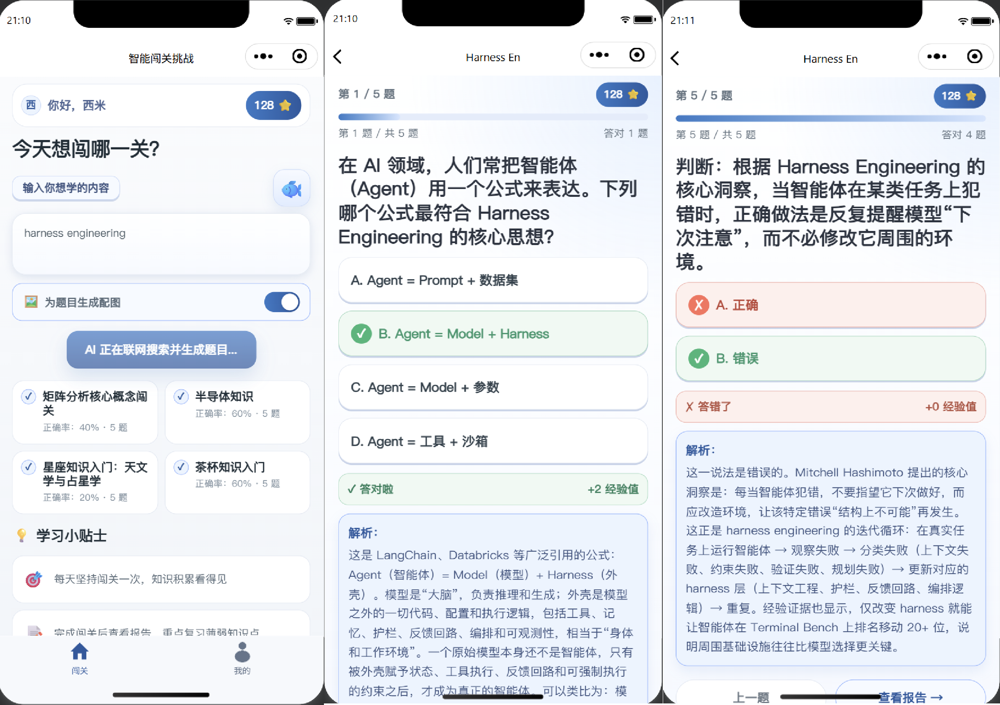
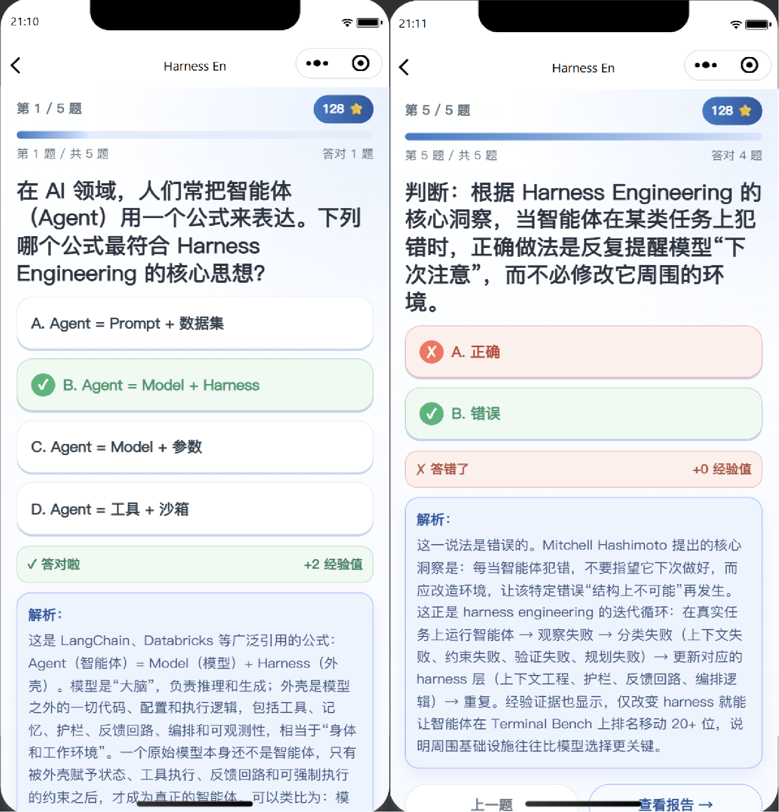
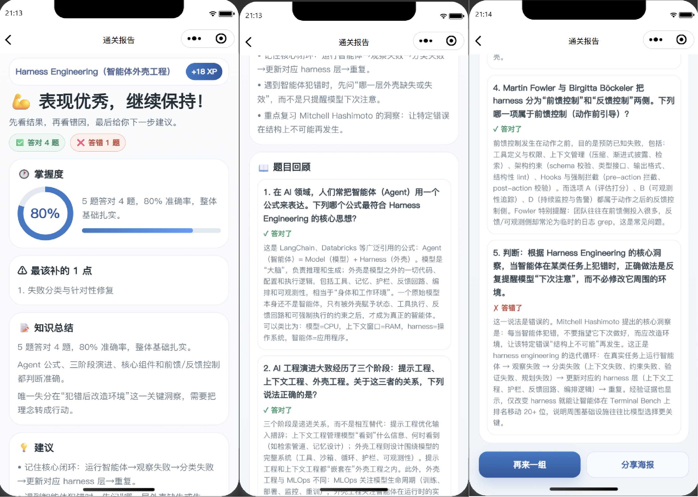
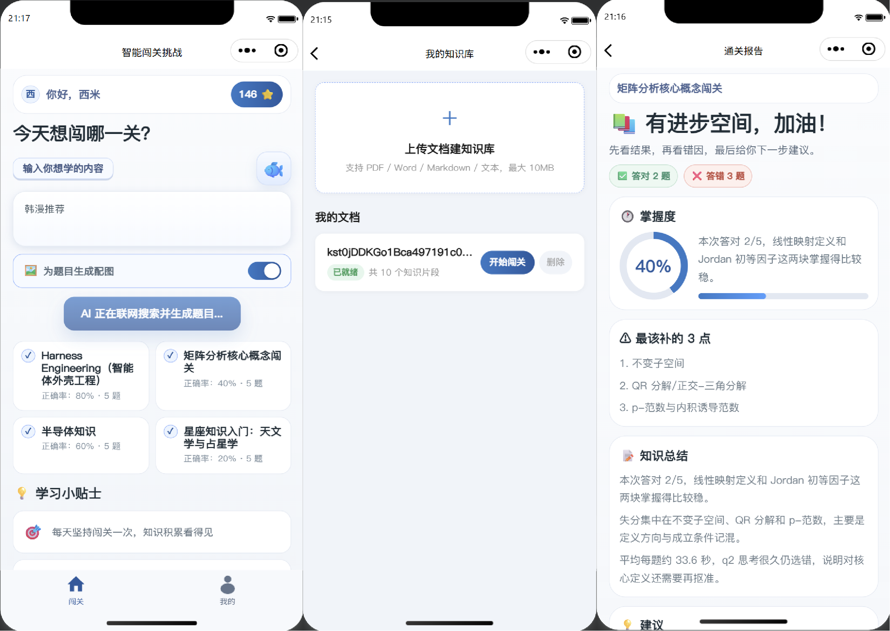
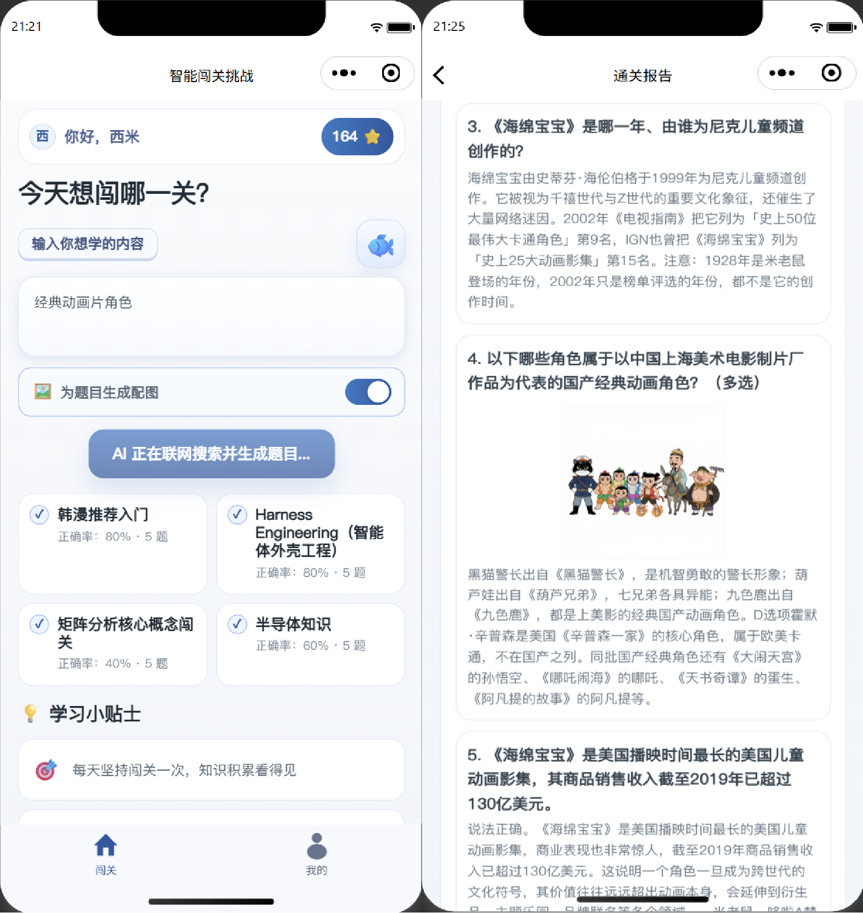
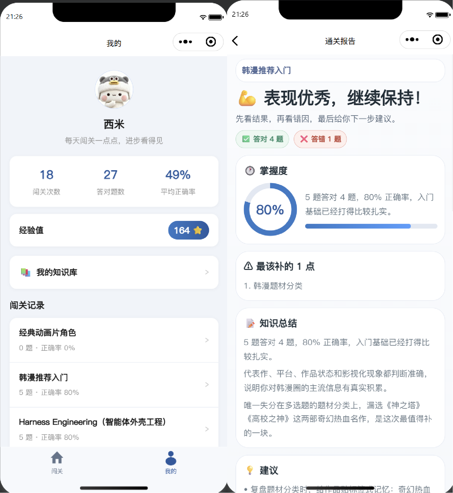
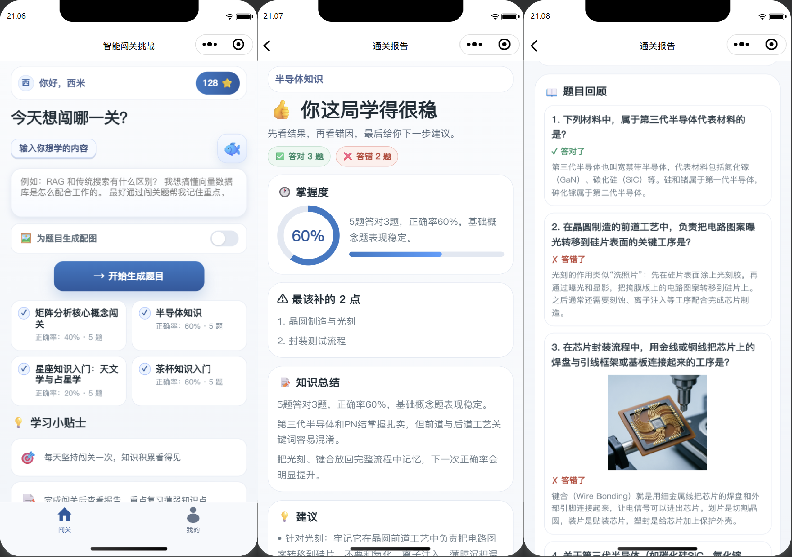

# 桃MOON智能闯关挑战小程序（TaoMOON-ai-learn）


## 一、项目介绍

输入一句话说出你想学什么，AI 自动联网搜索最新资料并生成一组闯关题目，边答边学，每答一题立刻给出答案和讲解，通关后还能拿到一份 AI 复盘报告。


### 为什么做这个项目？

学知识这件事，最大的敌人不是难，而是枯燥。看文档、看视频，看着看着就走神了，看完还是记不住。

而人天生喜欢玩游戏，喜欢闯关、答题、拿奖励。既然现在有了 AI，为什么不让 AI 把「我想学的任何知识」自动变成一局闯关游戏呢？

为什么做成微信小程序，而不是 App 或者网页？因为学习这件事发生在碎片时间里，微信小程序免安装、随时随地能打开、依托微信生态的流量入口、还便于分享给朋友一起卷，对一个学习类产品来说几乎是最优形态。

更重要的是，这个项目的骨架可以直接复用到任何垂直领域，换个知识源就是一个新产品，比如驾考宝典、面试题库、企业内部培训考核、职业资格考试复习、儿童英语单词闯关等等。


### 核心能力

1）一句话起题，AI 自动联网搜索并生成闯关题目。

大模型的知识有截止日期，所以项目给出题环节接入了 Tavily 联网搜索，用 LangGraph 做成了一个会自己决定搜什么、搜几轮的 ReAct Agent，保证题目不过时。




2）闯关答题，答完立刻判分和讲解。

支持单选、多选、判断三种题型，每题答完立刻高亮正确答案、标记错误选项，并给出解析和对应的知识点，答错也一样有讲解。




3）AI 生成通关复盘报告。

包含掌握度评分、薄弱知识点、三句话知识总结和下一步学习建议，还会结算本局获得的经验值。



4）上传私有文档，基于自己的知识库出题（RAG）。

支持 PDF、Word、Markdown、纯文本四种格式，文档会被自动解析、分块、向量化后存入 Chroma 向量库，之后就能基于这篇文档出题，适合企业培训考核、特定题库复习等场景。



5）AI 给题目配图，学得更直观。

调用通义千问文生图模型按知识点生成配图，并转存到腾讯云 COS 获得永久链接；配图由 AI 逐题判断是否真的需要（不是每道题都配），再叠加每日额度、匀速节流与限流重试来管住成本和稳定性。



6）微信一键登录，闯关记录随时回看。

采用微信静默登录，用户无感授权即可拥有账号。个人中心能看到累计经验值和历史闯关列表，点进任意一条还能回看当时的复盘报告。项目还做了「可选登录」设计，没登录也能完整体验核心流程。



## 二、更多介绍

该项目功能丰富，涵盖闯关答题、AI 出题、复盘报告、用户系统、知识库、AI 配图 6 大模块，30+ 功能点，覆盖了一个真实上线小程序的核心业务场景。

本项目以 Taro 微信小程序 + Python FastAPI + LangChain / LangGraph 为核心，前后端分离，综合运用了多种主流的小程序开发和 AI 应用开发技术。




### 技术选型

| 层面 | 技术选型 |
| --- | --- |
| 小程序前端 | Taro 4 · React 18 · TypeScript · Sass |
| 后端服务 | Python 3.11+ · FastAPI · Pydantic v2 · Uvicorn · asyncio |
| AI 编排 | LangChain · LangGraph · langchain-openai |
| 大模型 / 检索 | DeepSeek（出题 / 报告）· 阿里云百炼（Embedding / 文生图）· Tavily（联网搜索） |
| 向量检索 | Chroma（RAG 知识库） |
| 数据存储 | MySQL（aiomysql 异步连接池）· 腾讯云 COS（对象存储） |
| 鉴权 | 微信 `jscode2session` 静默登录 + JWT |
| 测试 | pytest · pytest-asyncio |
| 部署 | Docker · 微信云托管 · 云数据库 MySQL |
| AI 编程工具 | GitHub Copilot · Claude Code · OpenSpec · MCP · Agent Skills |
| AI 编程方法 | Harness Engineering · 规范驱动开发（SDD）· 原型赛马 · 上下文管理 |


## 三、快速运行


### 前置条件

- Python >= 3.11
- Node.js >= 18（推荐 20+）
- MySQL >= 8.0
- 微信开发者工具（[下载地址](https://developers.weixin.qq.com/miniprogram/dev/devtools/download.html)）
- 一个 [DeepSeek API Key](https://platform.deepseek.com/)（✅ 必需，用于 AI 出题和报告）
- 一个 [Tavily API Key](https://tavily.com/)（🔧 可选，用于联网搜索增强）
- 一个 [阿里云百炼 API Key](https://bailian.console.aliyun.com/)（🔧 可选，用于知识库 RAG 和 AI 生图）
- 一个 [腾讯云 COS](https://console.cloud.tencent.com/cos) 存储桶（🔧 可选，用于存储题目配图）
- 一个 [微信小程序测试号](https://developers.weixin.qq.com/sandbox)（🔧 可选，用于微信登录）

### 1. 克隆项目

```bash
git clone https://github.com/O2H2Y/TaoMOON-ai-learn.git
cd TaoMOON-ai-learn
```

### 2. 启动后端

```bash
cd backend

# 建议使用虚拟环境
python3 -m venv venv
source venv/bin/activate          # Windows: venv\Scripts\Activate.ps1

# 安装依赖（国内可加 -i https://pypi.tuna.tsinghua.edu.cn/simple 加速）
pip3 install -r requirements.txt

# 配置环境变量
cp .env.example .env              # 至少填写 DEEPSEEK_API_KEY 和 MYSQL_PASSWORD

# 启动服务（数据表会在启动时自动创建）
python3 -m uvicorn app.main:app --reload --host 0.0.0.0 --port 8000
```

启动成功后访问 [http://localhost:8000/docs](http://localhost:8000/docs)，能看到 FastAPI 接口文档即为正常。

> 数据库无需手动创建，`MYSQL_AUTO_INIT=true` 时启动会自动建库建 7 张表。也可以手动执行 `python3 scripts/init_mysql.py`。注意不要用 `sql/init_mysql.sql` 建表，该文件缺少 3 张表。

### 3. 启动前端

**新开一个终端**：

```bash
cd frontend
npm install                       # 国内可加 --registry=https://registry.npmmirror.com
npm run dev:weapp                 # 编译到 dist/ 并进入监听模式
```

然后用微信开发者工具新建项目，**目录选择 `frontend/dist`**，AppID 填测试号 AppID。

⚠️ 本地开发必须在开发者工具的「详情」到「本地设置」里 **勾选「不校验合法域名」**，否则请求 `localhost` 会被拦截。

生产构建（自动切换到线上后端地址）：

```bash
npm run build:weapp
```

### 4. 运行测试

```bash
cd backend
pytest
```

测试通过 mock 隔离了大模型和第三方接口调用，不消耗 API 额度。

### 5. 部署

`backend/Dockerfile` 提供了适配 **微信云托管** 的镜像构建文件，也可用于任意支持 Docker 的容器平台。部署所需的密钥类环境变量（数据库密码、各类 API Key、微信 AppSecret、`JWT_SECRET` 等）请通过平台的环境变量功能注入，**不要** 提交到代码仓库。
